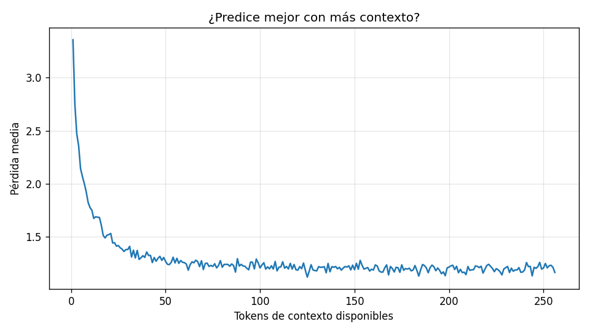

# Evaluación: mini-llm-colab

- Checkpoint: `/content/mini-llm/artifacts/checkpoints/mini-llm-colab/best.pt` (iteración 12000)
- Parámetros: 29,499,904
- Tokens evaluados: 863,744 (conjunto de validación completo)
- Fecha: 2026-10-18 21:57

## Métricas

| Modelo | Pérdida | Perplejidad |
|---|---|---|
| Uniforme (azar) | 9.011 | 8,192 |
| Unigrama (frecuencias) | 5.752 | 314.9 |
| Bigrama (token anterior) | 3.268 | 26.3 |
| **mini-GPT** | **1.286** | **3.6** |

- Precisión top-1: **63.4 %** del siguiente token acertado
- Precisión top-5: **90.2 %** con el correcto entre los 5 primeros
- Pérdida con 1 token de contexto: 3.356; con 256: 1.166
- Diversidad de las muestras (distinct-2): 0.86

## Muestras (temperatura 0.8, top-k 50)

**Había una vez**

> Había una vez un niño llamado Juan. Juan amaba los dulces. Un día, Juan vio a un perro. El perro era grande y tenía dientes grandes. Juan dijo: "¡Hola, perro! ¡Eres grande!" El perro dijo: "¡Woof!" Juan se asustó. El perro corrió hacia Juan. ¡El perro mordió a Juan! Juan lloró.  La mamá de Juan vio a Juan. Ella dijo: "¡Juan, Juan, no debes comer dulces!" Juan dijo: "¡No!" La mamá de Juan dijo: "No debes comer dulces, Juan." Juan dijo: "¡Sí, mamá!" Juan aprendió

**Un día, un niño llamado Tomás**

> Un día, un niño llamado Tomás estaba jugando en el parque. Estaba haciendo un castillo de arena y su mamá estaba allí. Miau era un niño pequeño y feliz.  "¡Mira, mamá! Es un castillo de arena", dijo Tomás. Su mamá sonrió. "Es muy bueno que hayas hecho un castillo tan alto", dijo.  Pero la mamá de Tomás fue muy pequeña y no sabía que hacer. Hizo que el castillo fuera muy pequeño. Tomás se puso triste.  "¡Mamá! ¡Mi castillo!", gritó.  Su mamá corrió a ayudarlo. Ella le dijo a valiosa: "No te preocupes, Tomás

**La niña tenía un gato que**

> La niña tenía un gato que amaba mucho al perro. El gato era suave y juguetón.  Un día, la niña vio a un hombre en el parque. El hombre tenía un gran carro. El hombre estaba jugando con el perro en el carro.  La niña pensó: "Este carro es mío. ¡Yo quiero jugar con el!". La niña le dijo al hombre: "Hola, ¿puedo jugar con tu perro?".  El hombre dijo: "No. Este perro es mío. Yo lo vi primero". La niña se puso triste. ¡Ella quería jugar con el perro!  La niña se sentó

**En el bosque vivía un oso**

> En el bosque vivía un oso grande y peludo. El oso tenía una cara muy, muy grande y un rostro muy grande. El oso era muy malo.  Un día, el oso estaba jugando con su pelota. La pelota salió volando y fue al bosque. El oso buscó su pelota por todos lados.  "¿Dónde está mi pelota?", preguntó el oso. Un conejo pequeño estaba en el bosque. "No se", dijo el conejo. "Está en el árbol grande". El oso quería su pelota.  "Yo te ayudo", dijo el oso. El oso saltó muy alto. El oso casi tocó la pelota

**Mamá dijo:**

> Mamá dijo: "¡No te preocupes, Lily! Podemos jugar afuera". Mamá sacó un gran plato de comida. ¡Era comida para perros! Lily se alegró. ¡Podía comer!  Pero cuando Lily tomó un bocado de la comida, ¡se hizo muy, muy enferma! ¡No podía jugar más! Mamá dijo: "¡Oh, Lily! Eres muy pequeña. ¡Necesitas descansar!". Lily estaba triste.  Mamá le dio a Lily un beso y le dijo: "¡Te quiero mucho, Lily!". Lily dijo: "¡Yo tambien te quiero, mamá!" Lily aprendió que no debe ser tan pequeña. ¡
