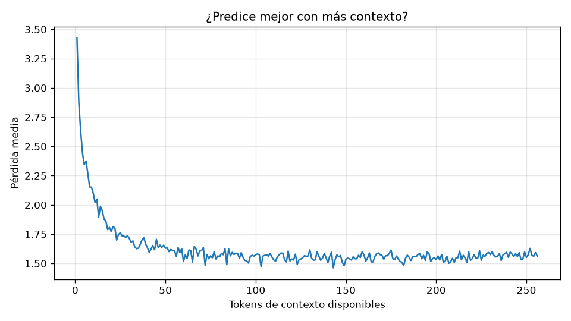

# Evaluación: mini-llm-cpu-256

- Checkpoint: `E:\AI\mini_llm\artifacts\checkpoints\mini-llm-cpu-256\best.pt` (iteración 6000)
- Parámetros: 5,836,032
- Tokens evaluados: 892,672 (conjunto de validación completo)
- Fecha: 2026-10-12 21:03

## Métricas

| Modelo | Pérdida | Perplejidad |
|---|---|---|
| Uniforme (azar) | 8.318 | 4,096 |
| Unigrama (frecuencias) | 5.810 | 333.5 |
| Bigrama (token anterior) | 3.250 | 25.8 |
| **mini-GPT** | **1.624** | **5.1** |

- Precisión top-1: **57.6 %** del siguiente token acertado
- Precisión top-5: **85.3 %** con el correcto entre los 5 primeros
- Pérdida con 1 token de contexto: 3.425; con 256: 1.562
- Diversidad de las muestras (distinct-2): 0.83

## Muestras (temperatura 0.8, top-k 50)

**Había una vez**

> Había una vez más grande!  Los amigos estaban muy tristes. "¡No son tan grandes!", dijeron. Entonces, los amigos dijeron: "¡Tenemos que comerlos!" ¡Los amigos no podían comer más!  Los amigos estaban tristes. No podían comer más. ¡Estaban tristes! Entonces, una niña vio a los amigos. "Está bien", dijo la niña. "¡Yo te voy a comer!"

**Un día, un niño llamado Tomás**

> Un día, un niño llamado Tomás entró en la cocina. Vio a su amigo, un gato llamado Mittens. Mittens estaba sentado en una caja.  "¡Mittens!" dijo Tom. "Tú puedes jugar contigo. Tienes que descansar." Mittens estaba triste. Él quería jugar con Mittens. "No quiero dormir," dijo Mittens. "Él se va a dormir."  Tom se fue a dormir. Él soñó con Mittens. Mittens quería dormir. Pero el no podía dormir. Mittens se despertó. Él estaba atrapado. Tom estaba triste.  Tom fue a buscar a Mittens. Él quería ayudar a Mittens. Él encontró una niña.

**La niña tenía un gato que**

> La niña tenía un gato que se iba a ver. El gato estaba jugando con una pelota. La niña estaba jugando con una pelota roja. ¡La pelota era grande y redonda!  La niña jugó con la pelota. La niña corrió y la atrapó. ¡Fue muy divertido! La niña se rió. ¡El gato era su amigo! No estaba hablando. ¡Era un gato! ¡Era muy divertido jugar con la niña!  La niña y el gato fueron al parque. Era un día divertido. La niña le dio al gato algunas golosinas. ¡El gato estaba muy feliz! El gato tambien estaba

**En el bosque vivía un oso**

> En el bosque vivía un oso de peluche. Era un día soleado y cálido. El oso de peluche tenía un gran ruido. El oso de peluche tenía una nariz roja.  El oso de peluche tenía una sonrisa grande. "Hola", dijo el oso. "Vamos a jugar". El oso dijo: "No, quiero jugar". El oso de peluche dijo: "¡Tengo que irme!". El oso dijo: "¡No!".  El oso se puso triste. El oso de peluche dijo: "¡Te dare un abrazo!". El oso dijo: "Vamos a rezar". El oso dijo: "¡Sí!". El oso dijo

**Mamá dijo:**

> Mamá dijo: "Max, el oso es muy viejo. No es tu papá, es para dormir". Mamá Oso le dio un abrazo. "Fue un buen día", dijo mamá Oso. "Gracias, Max", dijo mamá oso. "Te amo". Mamá Oso estaba feliz.  Al día siguiente, Max se despertó. El oso no estaba allí. "¡Mira, mamá!", dijo Max. "¡Un oso pequeño está en mi cama!" Mamá Oso sonrió. "No es un oso, Leo", dijo Mamá Oso. "Es un oso de peluche, no es un oso de peluche".  Leo se
